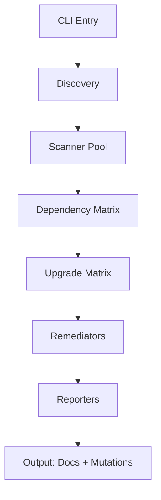

# DepShield Architecture

## System Overview

DepShield is a modular vulnerability remediation pipeline designed as a series of transformations:

```
Repos → Discovery → SBOM → Scanning → Matrices → Remediation → Reports
```

## High-Level Design

### 1. Core Components



**CLI** (`cli.py`): Click-based entry point with validation
**Discovery** (`discovery.py`): Detect ecosystems and build repo manifests
**Scanners** (`scanners/`): Parallel SBOM + vulnerability scanning
**Matrices** (`matrix/`): Cross-repo dependency analysis
**Remediators** (`remediation/`): Ecosystem-specific upgrade tools
**Reporters** (`reporters/`): Generate 7 markdown documentation files

### 2. Data Flow

```
RepoManifest
  ├── Syft SBOM → ScanResult (vulnerabilities list)
  ├── Grype/OSV/Trivy → deduplicated Vulnerability objects
  ├── DependencyMatrix → which deps in which repos
  └── UpgradeMatrix → safe versions for each CVE
  
RemediationResult → applied recipes + build/test status
  
Markdown output → docs/SBOM.md, VULNERABILITY_REPORT.md, etc.
```

### 3. Execution Phases

**Phase 1 — Discovery**
- Walk provided repo paths
- Detect ecosystem (pom.xml, package.json, go.mod, etc.)
- Build RepoManifest with build/test/lint commands

**Phase 2 — SBOM Generation**
- Parallel Syft invocation per repo
- Output CycloneDX JSON to `output/sbom/<repo>-sbom.json`

**Phase 3 — Vulnerability Scanning**
- Parallel Grype on each SBOM
- Sequential cross-check with OSV Scanner
- Aggregate into ScanResult.vulnerabilities (deduplicated by CVE ID)

**Phase 4 — Matrix Building**
- DependencyMatrix: dep → repos using it → versions
- UpgradeMatrix: package → current version → safe version → CVEs fixed
- Identify shared deps and version conflicts

**Phase 5 — Remediation** (optional, `--apply` only)
- Per repo, per ecosystem:
  - JVM: mvn/gradle openrewrite:run
  - Python: pip-audit --fix
  - JavaScript: npm audit fix --force
  - Go: go get -u
  - Rust: cargo update
- Git stash before, rollback on build/test failure

**Phase 6 — Documentation**
- System-level: SYSTEM_ARCHITECTURE.md, DEPENDENCY_MATRIX.md, UPGRADE_MATRIX.md, PIPELINE_SEQUENCE.md
- Per-repo (in `docs/`): SBOM.md, VULNERABILITY_REPORT.md, ARCHITECTURE.md, CODING_GUIDELINES.md, SEQUENCE_DIAGRAMS.md, TEST_CASES.md, UPGRADE_PLAN.md

### 4. Module Structure

```
depshield/
├── cli.py                   # Click CLI, option parsing, error handling
├── config.py               # Pydantic BaseSettings
├── models.py               # Dataclasses: Vulnerability, Dependency, RepoManifest, etc.
├── pipeline.py             # DepShieldPipeline orchestrates phases 1-6
├── discovery.py            # RepositoryDiscovery detects ecosystems and commands
│
├── scanners/
│   ├── base.py             # BaseScanner abstract class + subprocess runner
│   ├── sbom.py             # SyftScanner → CycloneDX JSON
│   ├── grype.py            # GrypScanner → parse vulnerabilities
│   ├── osv.py              # OSVScanner → Google OSV DB
│   └── trivy.py            # TrivyScanner → filesystem + containers
│
├── remediation/
│   ├── base.py             # BaseRemediator + git stash/rollback logic
│   ├── openrewrite.py      # Maven/Gradle OpenRewrite recipes
│   ├── pip_upgrader.py     # Python pip-audit
│   ├── npm_upgrader.py     # Node npm audit fix
│   ├── go_upgrader.py      # Go govulncheck
│   └── cargo_upgrader.py   # Rust cargo-audit
│
├── matrix/
│   ├── dependency_matrix.py # Cross-repo dependency table
│   └── upgrade_matrix.py    # Package → safe version mappings
│
└── reporters/
    ├── architecture.py      # System/component C4 diagrams
    ├── diagrams.py          # Mermaid generators (C4, sequence, flowchart)
    ├── sbom_report.py       # SBOM.md formatting
    ├── vuln_report.py       # VULNERABILITY_REPORT.md
    ├── coding_guidelines.py # Auto-detect conventions
    └── test_cases.py        # Test matrix and templates
```

### 5. Key Design Patterns

**Dataclass Pipeline**: All data is structured (ScanResult, RemediationResult) not strings. Reporters consume typed objects.

**Abstract Remediator Pattern**: Each ecosystem implements BaseRemediator with `remediate(dry_run=bool)`. Ecosystems are pluggable.

**Parallel Scanning, Sequential Remediation**: Scanning across repos in parallel (thread pool or asyncio). Remediation is sequential per repo to avoid lock file conflicts.

**Rollback Safety**: Before any remediation, `git stash`. If build/test fails post-upgrade, `git stash pop` and report failure without committing.

**Dry-Run Default**: `--dry-run` is default; only generates reports. `--apply` requires explicit `--no-dry-run --apply` flags.

## Integration Points

### External Tools

- **Syft**: SBOM generation (CycloneDX JSON format)
- **Grype**: Vulnerability scanning (JSON output)
- **osv-scanner**: Cross-check via Google OSV DB
- **Trivy**: Filesystem + container scanning
- **OpenRewrite**: Maven/Gradle recipe execution
- **pip-audit**: Python vulnerability fixes
- **npm audit**: JavaScript vulnerability fixes
- **govulncheck**: Go vulnerability detection
- **cargo-audit**: Rust vulnerability detection

### Configuration

Environment variables (via Pydantic BaseSettings):
```
DEPSHIELD_REPOS=./a ./b
DEPSHIELD_OUTPUT_DIR=./output
DEPSHIELD_DRY_RUN=true
DEPSHIELD_APPLY=false
DEPSHIELD_VERBOSE=false
DEPSHIELD_ECOSYSTEMS=jvm,python,javascript
```

CLI flags override env vars.

## Extensibility

### Adding a New Ecosystem

1. Create `depshield/remediation/<language>_upgrader.py`
2. Implement `class MyRemediator(BaseRemediator)` with `remediate(dry_run=bool)` method
3. Add detection in `discovery.py::_detect_ecosystems()`
4. Register in `pipeline.py::_get_remediator()`

### Custom Reports

Create `depshield/reporters/<custom>.py` with a reporter class. Invoke in `pipeline.py::_generate_*_reports()`.

## Security Considerations

- **No Root**: Runs unprivileged except Docker build
- **Rollback**: Git stash before mutations, auto-rollback on failure
- **Dry-Run**: Default mode generates reports without changes
- **Explicit Apply**: Requires `--no-dry-run --apply` to mutate
- **No Credential Leaks**: Tool output scrubbed before writing to reports

## Performance

- **Parallel Scanning**: 4 scanners (Syft, Grype, OSV, Trivy) run in parallel per repo
- **Sequential Remediation**: One ecosystem at a time per repo (lock file safety)
- **Caching**: SBOM results cached to `output/sbom/<repo>-sbom.json`

Typical run time:
- 1 small repo: 30-60 seconds
- 10 medium repos: 2-5 minutes
- 50 repos: 10-20 minutes (parallel factor limited by tool availability)
