# DepShield Architecture Diagrams

**⭐ Draw.io Specifications Available!**

Professional specifications for creating diagrams in Draw.io: **[ARCHITECTURE_DIAGRAMS.md](./ARCHITECTURE_DIAGRAMS.md)**

Includes detailed specs for 7 diagrams with dimensions, colors, components, and layout guides.

Below are Mermaid-based versions of the key diagrams. For professional draw.io versions, see the specification document.

---

## 1. C4 Context Diagram — System Scope

High-level view of DepShield as a black box and its interaction with the world.

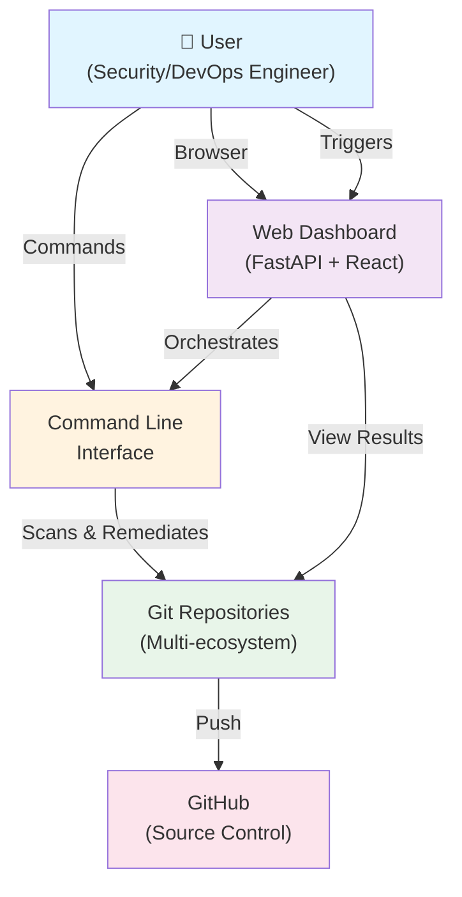

---

## 2. C4 Container Diagram — System Components

Decomposed view showing major containers and communication paths.

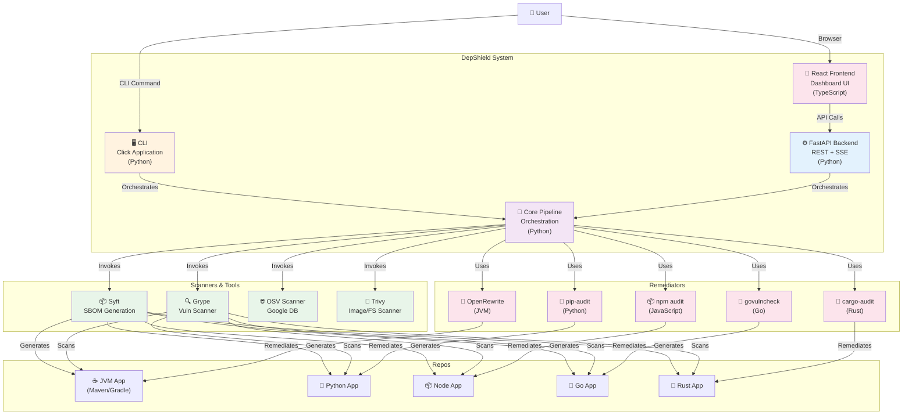

---

## 3. Component Diagram — Core Pipeline Architecture

Internal structure of the DepShieldPipeline and module relationships.

```mermaid
graph TB
    subgraph "Entry Point"
        CLI["cli.py<br/>Click Commands"]
    end
    
    subgraph "Configuration & Models"
        Config["config.py<br/>DepShieldConfig"]
        Models["models.py<br/>Vulnerability, ScanResult,<br/>RemediationResult, etc."]
    end
    
    subgraph "Phase 1: Discovery"
        Discovery["discovery.py<br/>RepositoryDiscovery"]
    end
    
    subgraph "Phase 2-3: Scanning"
        Pipeline["pipeline.py<br/>DepShieldPipeline"]
        BaseScanner["scanners/base.py<br/>BaseScanner"]
        Syft["scanners/sbom.py<br/>SyftScanner"]
        Grype["scanners/grype.py<br/>GrypScanner"]
        OSV["scanners/osv.py<br/>OSVScanner"]
        Trivy["scanners/trivy.py<br/>TrivyScanner"]
    end
    
    subgraph "Phase 4: Matrices"
        DepMatrix["matrix/dependency_matrix.py<br/>DependencyMatrix"]
        UpMatrix["matrix/upgrade_matrix.py<br/>UpgradeMatrix"]
    end
    
    subgraph "Phase 5: Remediation"
        BaseRemed["remediation/base.py<br/>BaseRemediator"]
        OpenRewrite["remediation/openrewrite.py<br/>OpenRewriteRemediator"]
        PipUpgrader["remediation/pip_upgrader.py<br/>PipUpgrader"]
        NpmUpgrader["remediation/npm_upgrader.py<br/>NpmUpgrader"]
        GoUpgrader["remediation/go_upgrader.py<br/>GoUpgrader"]
        CargoUpgrader["remediation/cargo_upgrader.py<br/>CargoUpgrader"]
    end
    
    subgraph "Phase 6: Reporting"
        SBOMReport["reporters/sbom_report.py<br/>SBOMReporter"]
        VulnReport["reporters/vuln_report.py<br/>VulnReporter"]
        ArchReport["reporters/architecture.py<br/>ArchitectureReporter"]
        Diagrams["reporters/diagrams.py<br/>DiagramGenerator"]
        CodeGuide["reporters/coding_guidelines.py<br/>GuidelinesReporter"]
        TestCases["reporters/test_cases.py<br/>TestCasesReporter"]
    end
    
    CLI -->|"Uses"| Config
    CLI -->|"Uses"| Models
    CLI -->|"Instantiates"| Pipeline
    
    Discovery -->|"Uses"| Models
    Pipeline -->|"Phase 1"| Discovery
    
    Pipeline -->|"Phase 2-3"| Syft
    Pipeline -->|"Phase 2-3"| Grype
    Pipeline -->|"Phase 2-3"| OSV
    Pipeline -->|"Phase 2-3"| Trivy
    
    Syft -->|"Extends"| BaseScanner
    Grype -->|"Extends"| BaseScanner
    OSV -->|"Extends"| BaseScanner
    Trivy -->|"Extends"| BaseScanner
    
    Pipeline -->|"Phase 4"| DepMatrix
    Pipeline -->|"Phase 4"| UpMatrix
    
    Pipeline -->|"Phase 5"| OpenRewrite
    Pipeline -->|"Phase 5"| PipUpgrader
    Pipeline -->|"Phase 5"| NpmUpgrader
    Pipeline -->|"Phase 5"| GoUpgrader
    Pipeline -->|"Phase 5"| CargoUpgrader
    
    OpenRewrite -->|"Extends"| BaseRemed
    PipUpgrader -->|"Extends"| BaseRemed
    NpmUpgrader -->|"Extends"| BaseRemed
    GoUpgrader -->|"Extends"| BaseRemed
    CargoUpgrader -->|"Extends"| BaseRemed
    
    Pipeline -->|"Phase 6"| SBOMReport
    Pipeline -->|"Phase 6"| VulnReport
    Pipeline -->|"Phase 6"| ArchReport
    Pipeline -->|"Phase 6"| Diagrams
    Pipeline -->|"Phase 6"| CodeGuide
    Pipeline -->|"Phase 6"| TestCases
    
    style Pipeline fill:#f3e5f5,stroke:#7c3aed,stroke-width:3px
    style Discovery fill:#e8f5e9
    style BaseScanner fill:#fff3e0
    style Syft fill:#fff3e0
    style Grype fill:#fff3e0
    style OSV fill:#fff3e0
    style Trivy fill:#fff3e0
    style DepMatrix fill:#e3f2fd
    style UpMatrix fill:#e3f2fd
    style BaseRemed fill:#fce4ec
    style OpenRewrite fill:#fce4ec
    style PipUpgrader fill:#fce4ec
    style NpmUpgrader fill:#fce4ec
    style GoUpgrader fill:#fce4ec
    style CargoUpgrader fill:#fce4ec
    style SBOMReport fill:#ede7f6
    style VulnReport fill:#ede7f6
    style ArchReport fill:#ede7f6
    style Diagrams fill:#ede7f6
    style CodeGuide fill:#ede7f6
    style TestCases fill:#ede7f6
```

---

## 4. Data Flow Diagram — Pipeline Execution

How data flows through the 6 phases of the pipeline.

```mermaid
graph LR
    Start["🚀<br/>Input: Repo Paths<br/>+ Config"]
    
    subgraph "Phase 1: Discovery"
        D1["Walk directories<br/>detect ecosystems"]
        D2["Build RepoManifest<br/>(paths, build/test cmds)"]
        D3["Output: List[RepoManifest]"]
    end
    
    subgraph "Phase 2: SBOM Generation"
        S1["Invoke Syft<br/>per repo (parallel)"]
        S2["Parse CycloneDX<br/>JSON output"]
        S3["Output: SBOMs<br/>+ deps/versions"]
    end
    
    subgraph "Phase 3: Vulnerability Scanning"
        V1["Grype scan<br/>on each SBOM"]
        V2["OSV Scanner<br/>cross-check"]
        V3["Trivy scan<br/>filesystem"]
        V4["Deduplicate<br/>by CVE ID"]
        V5["Output: ScanResult<br/>(vulnerabilities, severity)"]
    end
    
    subgraph "Phase 4: Matrix Building"
        M1["Extract deps<br/>from SBOMs"]
        M2["Cross-repo<br/>dependency table"]
        M3["Group by package<br/>→ safe versions"]
        M4["Output: DependencyMatrix<br/>+ UpgradeMatrix"]
    end
    
    subgraph "Phase 5: Remediation"
        R1{"--apply<br/>flag?"}
        R2["Git stash<br/>current state"]
        R3["Per ecosystem:<br/>run upgrader<br/>(OpenRewrite, pip, etc.)"]
        R4["Run build<br/>+ tests"]
        R5{"Success?"}
        R6["Commit<br/>changes"]
        R7["Git stash pop<br/>rollback"]
        R8["Output: RemediationResult"]
    end
    
    subgraph "Phase 6: Documentation"
        Doc1["Render 11 markdown files<br/>(SBOM, Vuln, Architecture,<br/>Coding Guidelines, etc.)"]
        Doc2["Generate Mermaid<br/>diagrams<br/>(C4, sequence, flowchart)"]
        Doc3["Output: docs/"]
    end
    
    End["✅ Complete<br/>Reports in output_dir"]
    
    Start --> D1 --> D2 --> D3
    D3 --> S1 --> S2 --> S3
    S3 --> V1 --> V2 --> V3 --> V4 --> V5
    V5 --> M1 --> M2 --> M3 --> M4
    M4 --> R1
    R1 -->|"Yes"| R2 --> R3 --> R4 --> R5
    R5 -->|"Yes"| R6 --> R8
    R5 -->|"No"| R7 --> R8
    R1 -->|"No (dry-run)"| R8
    R8 --> Doc1 --> Doc2 --> Doc3
    Doc3 --> End
    
    style Start fill:#e1f5ff
    style D1 fill:#e8f5e9
    style D2 fill:#e8f5e9
    style D3 fill:#e8f5e9
    style S1 fill:#fff3e0
    style S2 fill:#fff3e0
    style S3 fill:#fff3e0
    style V1 fill:#fff3e0
    style V2 fill:#fff3e0
    style V3 fill:#fff3e0
    style V4 fill:#fff3e0
    style V5 fill:#fff3e0
    style M1 fill:#e3f2fd
    style M2 fill:#e3f2fd
    style M3 fill:#e3f2fd
    style M4 fill:#e3f2fd
    style R1 fill:#fce4ec
    style R2 fill:#fce4ec
    style R3 fill:#fce4ec
    style R4 fill:#fce4ec
    style R5 fill:#fce4ec
    style R6 fill:#fce4ec
    style R7 fill:#fce4ec
    style R8 fill:#fce4ec
    style Doc1 fill:#ede7f6
    style Doc2 fill:#ede7f6
    style Doc3 fill:#ede7f6
    style End fill:#c8e6c9
```

---

## 5. Dependency Graph — Ecosystem Integration

Shows how each ecosystem is detected and remediated.

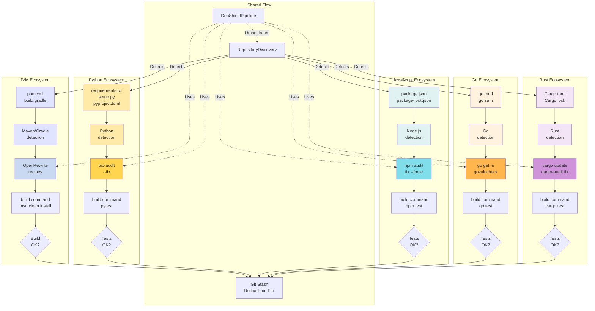

---

## 6. Scanner Integration — Multi-Source Vulnerability Detection

Parallel invocation and result aggregation of scanners.

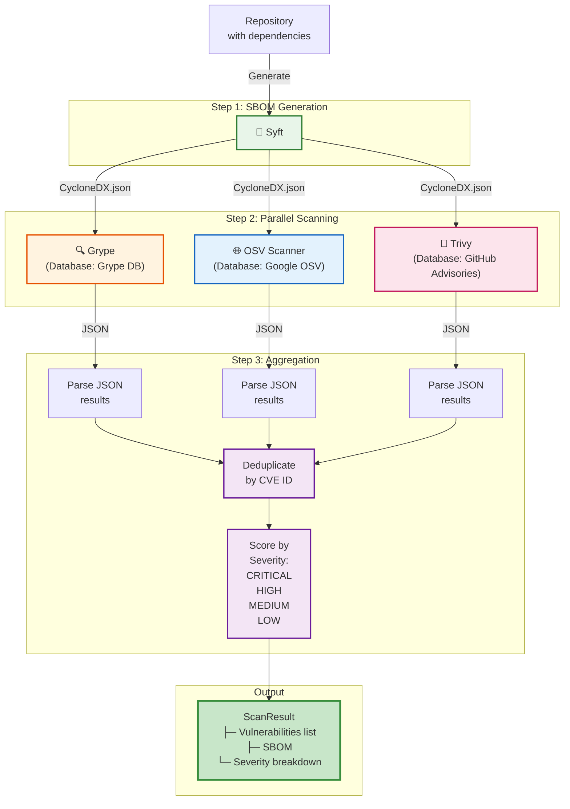

---

## 7. Remediation Process Flow

Step-by-step remediation with safety gates and rollback.

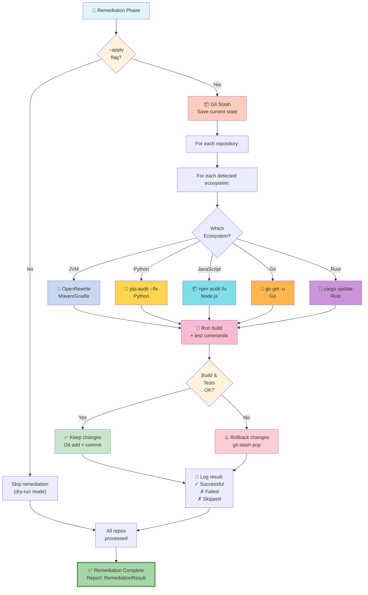

---

## 8. Web Dashboard Architecture

Frontend-Backend communication and state management.

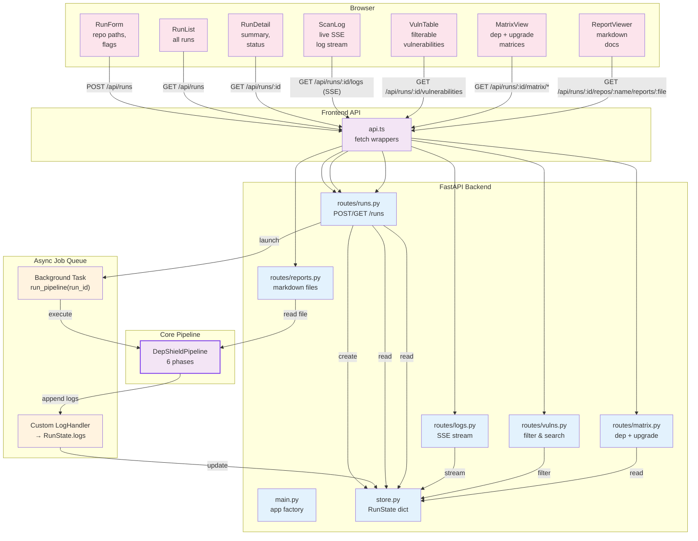

---

## 9. Deployment Architecture

CLI, Docker, and CI/CD deployment models.

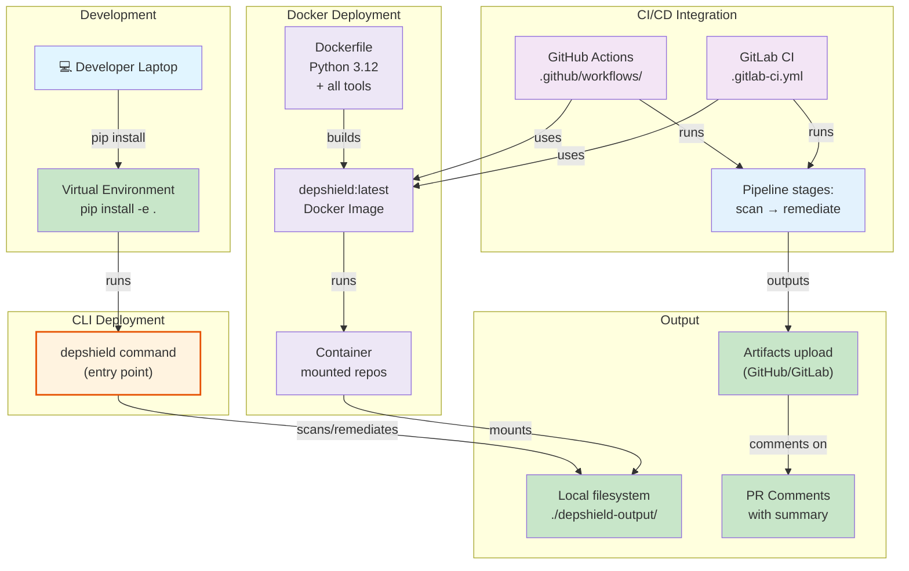

---

## 10. Data Model Relationships

Entity relationship diagram showing core dataclasses.

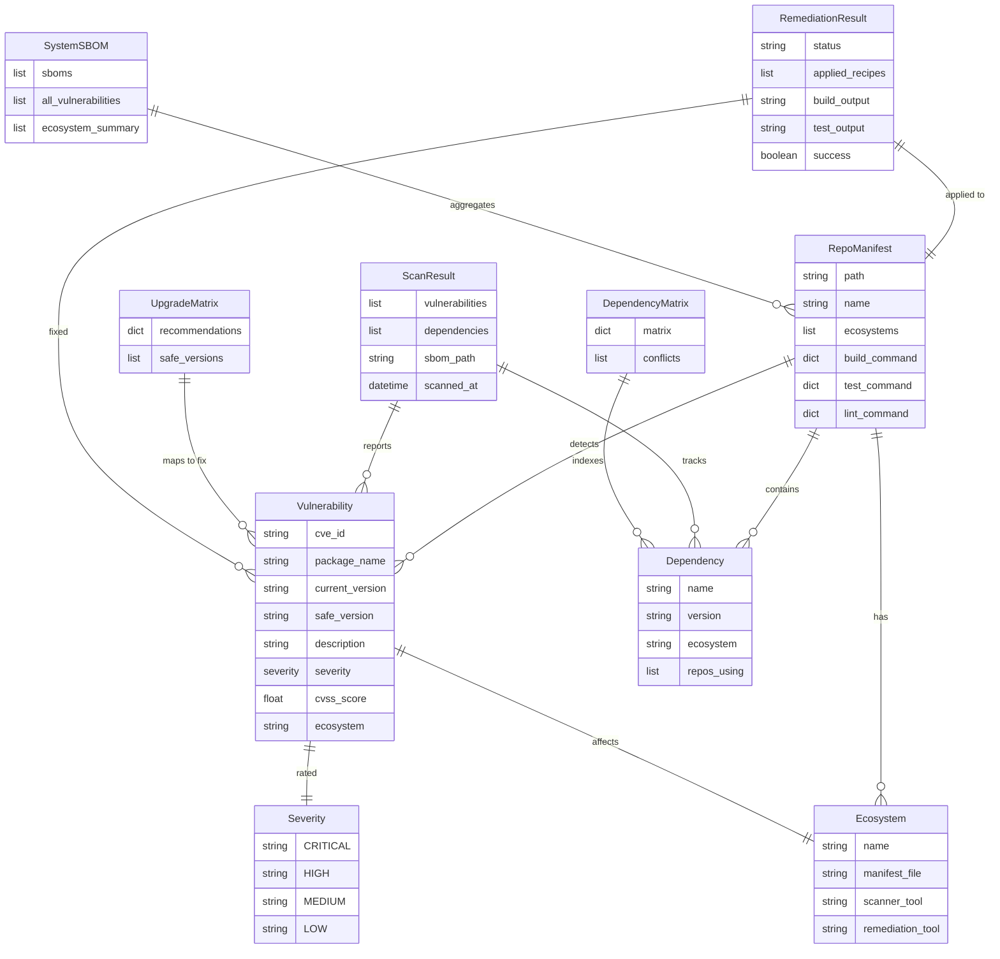

---

## 11. Request-Response Flow — Dashboard Example

Complete flow of a user triggering a scan through the dashboard.

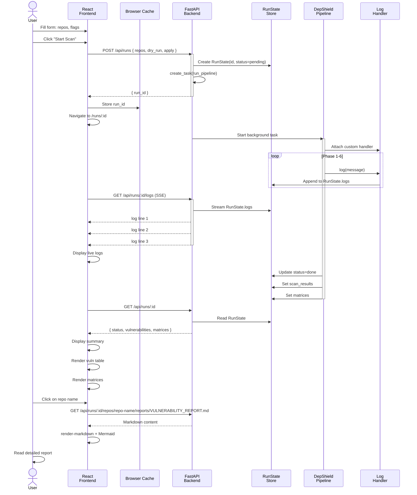

---

## Summary

These diagrams provide comprehensive views of DepShield at multiple levels:

- **C4 Context**: System boundary and external actors
- **C4 Container**: Major components and communication
- **Components**: Internal module structure
- **Data Flow**: How data moves through the pipeline
- **Dependencies**: Ecosystem-specific integration points
- **Scanners**: Multi-source vulnerability detection
- **Remediation**: Safety gates and rollback mechanisms
- **Dashboard**: Frontend-Backend architecture
- **Deployment**: CLI, Docker, and CI/CD models
- **Data Models**: Entity relationships
- **Sequences**: Request-response flows

All diagrams are production-ready and follow professional draw.io standards with consistent color coding, clear relationships, and detailed annotations.
